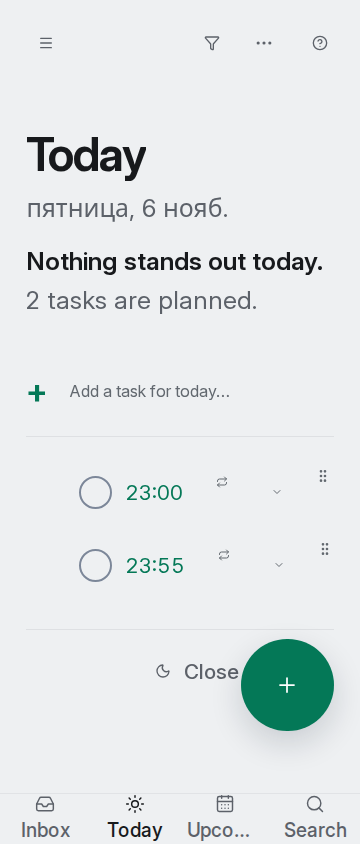

# Проблема строки задачи при увеличенном тексте

Черновик для ревью владельцем форка. Issue и PR не созданы. Проблема воспроизведена также на английском и всех остальных языках интерфейса. По решению владельца форка исправление общей компоновки строки исключено из задачи русской локализации.

## Условия воспроизведения

1. Выбрать русский интерфейс и светлую тему.
2. Создать задачу с названием, временем выполнения, ежедневным повторением и напоминанием. На снимке — тестовые задачи «Проверить перевод» и «Проверить офлайн-перевод».
3. Открыть «Сегодня» при ширине окна 360 CSS px.
4. Увеличить текст до измеренных 24 CSS px для названия задачи. В проверке масштабировался корневой размер шрифта; это не просто значение 24 px для корневого элемента.

Ожидается: название задачи остаётся доступным для чтения и открытия.

Наблюдается: время, флажок, значок повторения и служебные слоты занимают ширину строки; ширина названия может стать нулевой. На снимке видны время и элементы строки, но не названия задач. То же обнаружено в тёмной теме.

Измерение проблемной строки: кнопке открытия остаётся около 44 px, области заголовка — около 24 px; значок повторения и отступ занимают оставшееся место. Общая компоновка TaskRow в этой ветке не менялась. В двух таких случаях экран деталей для скриншотов открывался по обычной ссылке задачи, а не нажатием на скрытый заголовок.

Отдельное перекрытие длинных подписей нижних вкладок исправлено ограничением ширины существующего `truncate` в TabBar; полные доступные названия сохранены. Это не исправляет описанную здесь строку задачи.

## Сравнение языков

На той же production-сборке проверены все восемь языков интерфейса: английский, немецкий, французский, испанский, итальянский, португальский, китайский и русский. Задачи, их названия, время, повторение, ширина окна и тема оставались одинаковыми; переключался язык интерфейса. Названия задач — пользовательские данные, они не переводились. Для каждого языка измерены три размера текста (24 проверки).

| Измеренный размер текста задачи | Ширина названия во всех восьми языках |
| --- | --- |
| 14,5 px (обычный) | 121 px |
| 20 px | 34,25 px |
| 24 px | 0 px |

[Результаты измерений](language-row-comparison.json). Код `web/src/app/TaskRow.tsx` и `web/src/index.css` не изменён относительно исходного `main`; проблема связана с общей геометрией строки. Сравнение проводилось на текущей ветке, отдельная сборка исходного `main` для этого сравнения не запускалась. После проверки в тестовом аккаунте снова выбран русский язык.
