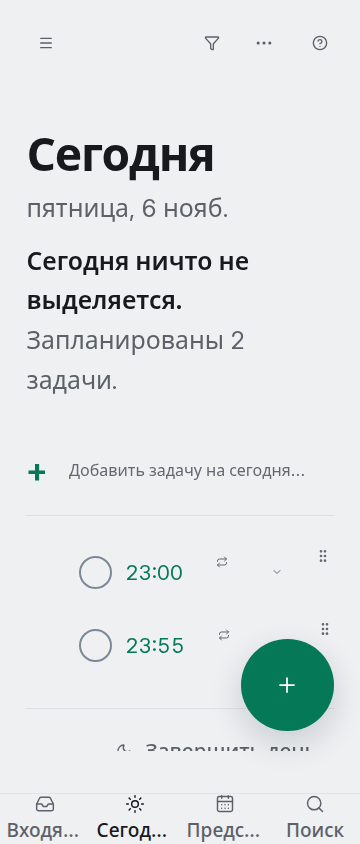

# Проблема строки задачи при увеличенном тексте

Черновик для ревью владельцем форка. Issue и PR не созданы. Исправление общей компоновки строки в этой ветке пока не выполнено и требует отдельного решения.

## Условия воспроизведения

1. Выбрать русский интерфейс и светлую тему.
2. Создать задачу с названием, временем выполнения, ежедневным повторением и напоминанием. На снимке — тестовые задачи «Проверить перевод» и «Проверить офлайн-перевод».
3. Открыть «Сегодня» при ширине окна 360 CSS px.
4. Увеличить текст до измеренных 24 CSS px для названия задачи. В проверке масштабировался корневой размер шрифта; это не просто значение 24 px для корневого элемента.

Ожидается: название задачи остаётся доступным для чтения и открытия.

Наблюдается: время, флажок, значок повторения и служебные слоты занимают ширину строки; ширина названия может стать нулевой. На снимке видны время и элементы строки, но не названия задач. То же обнаружено в тёмной теме.

Измерение проблемной строки: кнопке открытия остаётся около 44 px, области заголовка — около 24 px; значок повторения и отступ занимают оставшееся место. Общая компоновка TaskRow в этой ветке не менялась. В двух таких случаях экран деталей для скриншотов открывался по обычной ссылке задачи, а не нажатием на скрытый заголовок.

Отдельное перекрытие длинных подписей нижних вкладок исправлено ограничением ширины существующего `truncate` в TabBar; полные доступные названия сохранены. Это не исправляет описанную здесь строку задачи.
